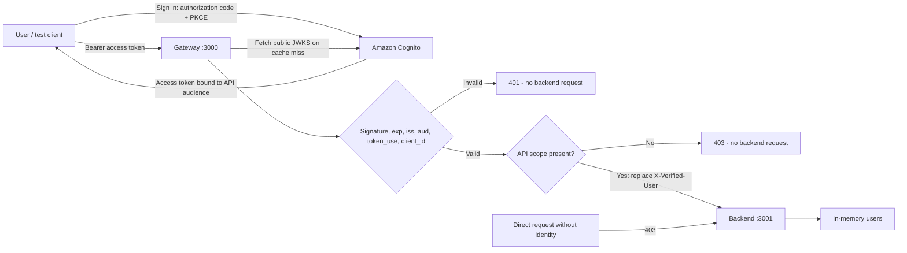

# Secure Entry

A Node.js/TypeScript gateway authenticates Cognito access tokens before forwarding user API requests to an isolated Express backend. The backend manages an in-memory user list and trusts the gateway's `X-Verified-User` header; it never parses or validates JWTs.

## Traffic flow and trust boundary



**A header is not proof of origin.** A caller who can reach the backend and forge `X-Verified-User` can impersonate a user. The supplied Docker Compose topology therefore publishes only the gateway and places the backend on an internal network shared with the gateway. Its port is not published. The backend rejects requests without the header, while the gateway replaces caller-supplied identity and strips credentials and forwarding headers.

The native two-process mode binds both services to loopback for local development. Local processes and Docker administrators are trusted in this PoC. A production deployment would enforce gateway-only ingress using network policy/security groups and mutually authenticated service transport. This project does not claim that header presence alone establishes Zero Trust.

## Quick start

Prerequisites: Node.js 24, npm, Python 3, AWS CLI v2 with Cognito administration permissions, and Docker Compose for the isolated topology. No AWS credentials are needed for the automated tests.

```sh
npm ci
npm run check

# Check the account and region before provisioning dedicated challenge resources.
aws sts get-caller-identity
aws configure get region
npm run setup:cognito

docker compose up --build -d
npm run login
# Open the printed URL. Username: challenge-reviewer
# Read the generated password locally from .local/test-user-password.
# On successful sign-in, the helper verifies and saves .local/access-token.
npm run smoke
```

The smoke test checks 401 rejection with no token, a forged identity header, and an invalid token; it then performs real-token list, create, read, update, delete, validation-failure, and not-found requests. It deletes its own test user record afterward. Cognito's test login user is a separate identity from the API's in-memory user records.

`docker compose down` stops the application. It does not delete Cognito resources. Restarting the backend clears the user list.

### Run without Docker

```sh
npm run build
npm run start:backend    # terminal 1
npm run start:gateway    # terminal 2
npm run login           # terminal 3
npm run smoke
```

Use the same `.env` generated by provisioning. Stop a running Docker stack first to free port 3000. The direct backend port is accessible to local processes in this development mode.

## Cognito and environment setup

`scripts/provision-cognito.py` uses AWS CLI to create a dedicated user pool, API resource server, public app client, managed login domain/style, and confirmed test user. It generates a random password and suppresses invitation email. It saves progress in `.local/cognito.json`, resumes completed steps on repeat runs, and refuses to use that state with a different account or region. Preserve `.local/cognito.json` if provisioning is interrupted. It is a bootstrap helper for a dedicated PoC, not a general infrastructure drift reconciler.

The pool uses **Essentials with managed login v2**, authorization code flow, and an API resource indicator. The CLI's ordinary `initiate-auth` access token and classic hosted UI do not provide the required resource-bound `aud` claim for this flow. The application deliberately rejects those tokens, as well as ID tokens. The login helper supplies `resource=OIDC_AUDIENCE`, S256 PKCE and random `state`, validates the returned access token, then saves only that token. It never saves ID or refresh tokens. Tokens expire after 15 minutes; run `npm run login` again to renew.

Essentials has a free tier for direct user sign-ins, shared across an AWS account/organization. This setup creates one user, no SMS/email delivery, no Lambda, no client-credentials grants, and no compute deployment in AWS. Consult [current Cognito pricing](https://aws.amazon.com/cognito/pricing/) for account-wide usage and limits.

Alternatively, copy `.env.example` to `.env` and configure an existing Cognito pool:

| Variable | Meaning |
| --- | --- |
| `OIDC_ISSUER` | Exact issuer, e.g. `https://cognito-idp.us-east-1.amazonaws.com/us-east-1_EXAMPLE` |
| `OIDC_JWKS_URI` | Trusted HTTPS JWKS URL from the pool's discovery document |
| `OIDC_AUDIENCE` | API resource identifier, default `https://secure-entry.example/api` |
| `OIDC_CLIENT_ID` | Public application client ID; no client secret |
| `COGNITO_DOMAIN` | Managed login origin, used only by the login helper |
| `BACKEND_URL` | Fixed backend origin; defaults in the example to `http://127.0.0.1:3001` |
| `GATEWAY_HOST`, `GATEWAY_PORT` | Native listener defaults: `127.0.0.1:3000` |
| `BACKEND_HOST`, `BACKEND_PORT` | Native listener defaults: `127.0.0.1:3001` |

For an existing pool, enable managed login v2 and an app-client branding style, register `http://localhost:8085/callback`, allow `code`, `openid`, and the resource-server scope `${OIDC_AUDIENCE}/users`. Create a confirmed test user. `secure-entry.example` is an audience identifier; no website or DNS registration is required. The backend container receives none of the OIDC configuration or AWS credentials.

`.env`, `.local/`, generated tokens, passwords, build output and dependencies are excluded from Git and Docker build context. Do not publish a real `.env` or test-user credentials. The `.env.example` contains placeholders only.

## API and policy

Every API request requires an RS256 access token with valid `exp`, `iss`, `aud`, nonempty header-safe `sub`, `token_use=access`, matching `client_id`, and scope `${OIDC_AUDIENCE}/users`. A present `nbf` is also validated. A single API scope grants all CRUD operations; there are no invented roles, record ownership rules, or per-user data partitions.

| Request | Success | Behavior |
| --- | --- | --- |
| `GET /api/users` | 200 | Array of all users, initially empty |
| `GET /api/users/:id` | 200 | One user; unknown ID returns 404 |
| `POST /api/users` | 201 | Creates UUID; returns record and `Location` |
| `PUT /api/users/:id` | 200 | Replaces name and email; preserves ID |
| `DELETE /api/users/:id` | 204 | Deletes record; empty response body |

POST and PUT accept only `{ "name": "...", "email": "..." }` as JSON. Name is trimmed and limited to 100 characters. Email is trimmed, syntactically checked and limited to 254 characters; this does not verify mailbox ownership. Unknown fields, empty values and control characters are rejected. PUT requires both fields. Bodies are limited to 16 KiB and compressed bodies are rejected.

Errors use `{ "error": "...", "requestId": "..." }`. Codes: 400 invalid input/JSON/path, 401 invalid authentication, 403 missing gateway identity or insufficient scope, 404 absent resource, 405 unsupported method, 413 oversized body, 415 unsupported media/encoding, 500 unexpected internal error, 502 unavailable/stalled backend. Stack traces, raw tokens and provider exception text are never sent to clients. Node's HTTP parser may reject malformed protocol requests before Express with its own 400 response.

Gateway `GET /health` is a local liveness check and never calls the backend or IdP. It does not prove authentication readiness. Use `npm run smoke` for that.

### Manual success and failure scenarios

After login, define a small shell helper that reads the token from its protected file. Do not enable shell tracing or print the token.

```sh
api() {
  { printf 'Authorization: Bearer '; cat .local/access-token; printf '\n'; } |
    curl --silent --show-error --include --header @- "$@"
}

api http://localhost:3000/api/users
api -X POST http://localhost:3000/api/users \
  -H 'Content-Type: application/json' \
  -d '{"name":"Example User","email":"user@example.test"}'

# Copy the returned UUID into USER_ID.
USER_ID=REPLACE_WITH_RETURNED_UUID
api "http://localhost:3000/api/users/$USER_ID"
api -X PUT "http://localhost:3000/api/users/$USER_ID" \
  -H 'Content-Type: application/json' \
  -d '{"name":"Updated User","email":"updated@example.test"}'
api -X DELETE "http://localhost:3000/api/users/$USER_ID"

# All return 401 without reaching the backend:
curl -i http://localhost:3000/api/users
curl -i http://localhost:3000/api/users -H 'Authorization: Bearer invalid'
curl -i http://localhost:3000/api/users -H 'X-Verified-User: forged'

# 400 validation error:
api -X POST http://localhost:3000/api/users \
  -H 'Content-Type: application/json' -d '{"name":"","email":"bad"}'
```

With Docker running, `curl --max-time 2 http://localhost:3001/api/users` must fail to connect because the backend port is not published. To exercise its missing-header guard from inside the private network:

```sh
docker compose exec -T gateway node --input-type=module -e \
  'const r = await fetch("http://backend:3001/api/users"); console.log(r.status, await r.text()); if (r.status !== 403) process.exitCode = 1;'
```

In native mode, `curl -i http://localhost:3001/api/users` returns 403. Adding a forged identity directly in native mode will succeed by the specified header contract; network isolation is essential, not optional.

## Implementation and verification

```text
gateway/src/   authentication.ts | policy.ts | proxy.ts | logging.ts | app.ts | server.ts
backend/src/   app.ts | server.ts
shared/        HTTP context/errors, configuration and process lifecycle
tests/         JWT/JWKS, complete HTTP flow, proxy failures, config/errors
scripts/       Cognito bootstrap, PKCE login, live smoke test
```

Authentication, scope policy, and streaming proxying are independent modules. Express app factories have no startup side effects. `jose` performs JWT cryptography and maintains one in-process JWKS resolver per gateway: 10-minute cache lifetime, 30-second unknown-key refresh cooldown, 3-second fetch timeout, and shared concurrent fetches. Keys never come from token-supplied URLs. Unknown signing keys fail closed during cooldown and can be resolved after it; keys removed at the provider may remain usable until the local cache expires. Fresh cached keys remain usable during an IdP outage. Cold/expired-cache outages return 401 with a diagnostic log code.

The proxy uses a fixed upstream origin, streams bodies without a second parser, applies a 5-second total deadline, cancels abandoned requests and strips bearer tokens/cookies/forwarded identity. Only a small header allowlist crosses to the backend. A gateway-generated UUID is returned as `X-Request-ID` and preserved in backend error bodies for correlation.

```sh
npm run lint
npm run typecheck
npm test
npm run test:coverage
npm run build
npm audit --omit=dev --audit-level=high
# Or run lint, types, coverage and build together:
npm run check
```

Tests generate ephemeral RSA keys and serve a mock JWKS over localhost; they never require live AWS credentials. They cover signature tampering, algorithm confusion, required claims, issuer/audience/expiry/not-before, ID-token rejection, client mismatch, unsafe subjects, JWKS reuse/concurrency/rotation/outages, blocked forwarding, identity spoofing, credential stripping, logging redaction, full CRUD, body validation, direct-backend rejection, and upstream failure/cancellation. Coverage thresholds gate the core request logic. Thin process startup wrappers are excluded; Docker/native smoke checks exercise startup separately.

GitHub Actions runs a clean install, lint, strict TypeScript checks, tests with coverage thresholds, compilation, a production-dependency audit, and the Docker build. Live Cognito sign-in stays an explicit local check; no secrets are stored in CI.

## Logs and troubleshooting

Gateway request logs are JSON on stdout. Every completed/aborted request records `timestamp`, `method`, `path`, socket `sourceIp`, verified `userId` or null, `requestId`, `status`, and `durationMs`. Failures add a stable `failureCode`. Query strings, request bodies, cookies, authorization headers and raw errors are excluded. Source IP is the direct TCP peer; untrusted `X-Forwarded-For` is ignored. Behind Docker/NAT it can be a bridge address.

```sh
docker compose logs gateway
docker compose ps
```

| Symptom | Check |
| --- | --- |
| 401 / `ERR_JWT_EXPIRED` | Run `npm run login`; tokens last 15 minutes |
| 401 / claim validation failure | Exact issuer/audience/client; use a resource-bound access token from managed login v2 |
| 401 / no matching key | Signing-key rotation cooldown, trusted JWKS URL, IdP connectivity |
| 403 at gateway | Token must contain the API `/users` scope |
| 403 at backend | Request did not contain the gateway identity header |
| 502 | Backend startup/address or the 5-second upstream deadline |
| Startup configuration error | Compare `.env` to `.env.example`; OIDC URLs must be HTTPS |
| Browser callback looks blocked | Check the login terminal for verified-token success; it closes its callback server after one use |

## PoC limits and cleanup

The in-memory list is deliberately ephemeral and shared across authorized users. The public-facing demo listener is loopback HTTP; use TLS before exposing it remotely. JWT verification is offline, so Cognito logout/revocation does not immediately invalidate a still-valid token at this gateway; expiry limits that window. Production needs deliberate network identity/TLS, rate limiting, durable storage, secrets management and operational log retention. None are required to run this challenge.

To remove AWS resources after review, first read `.local/cognito.json` and confirm the pool/domain are this challenge's resources. Then run these AWS CLI commands with those recorded values:

```sh
aws cognito-idp delete-user-pool-domain --region REGION --user-pool-id POOL_ID --domain DOMAIN_PREFIX
aws cognito-idp delete-user-pool --region REGION --user-pool-id POOL_ID
```

This deletes the test identity, client and pool permanently. Do not run cleanup until reviewers have finished. Remove local credentials separately after cleanup.

## References

- [Cognito access-token claims](https://docs.aws.amazon.com/cognito/latest/developerguide/amazon-cognito-user-pools-using-the-access-token.html)
- [Cognito authorization endpoint and PKCE](https://docs.aws.amazon.com/cognito/latest/developerguide/authorization-endpoint.html)
- [Cognito resource binding](https://docs.aws.amazon.com/cognito/latest/developerguide/cognito-user-pools-define-resource-servers.html#cognito-user-pools-resource-servers-resource-binding)
- [jose remote JWKS caching](https://github.com/panva/jose/blob/main/docs/jwks/remote/functions/createRemoteJWKSet.md)
